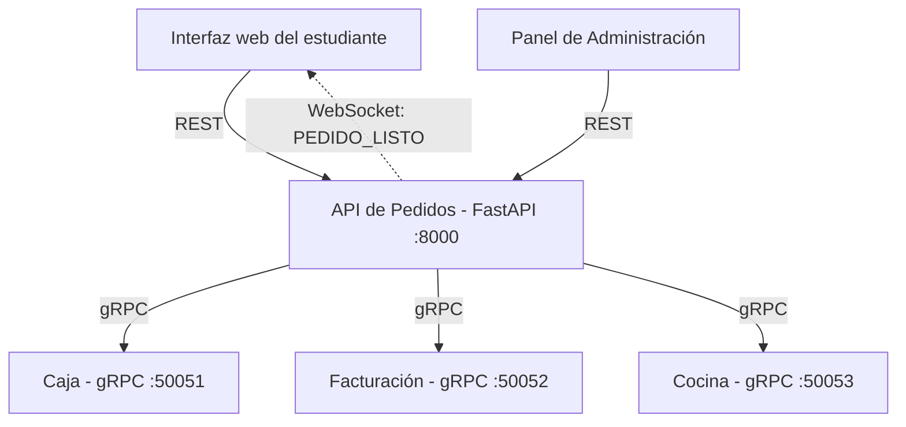

# Sistema Distribuido de Cafetería Universitaria

**Práctica 03 — Sistemas Distribuidos**  
Realizado por: Bryam Andres Mejia Morocho
Universidad Politécnica Salesiana (UPS)  
Carrera de Computación

## 1. Descripción del proyecto

Este proyecto consiste en el desarrollo de un sistema distribuido para gestionar los pedidos de una cafetería universitaria.

La aplicación permite que los estudiantes creen pedidos desde una interfaz web, consulten su estado y reciban una notificación cuando estén listos para retirarlos.

El sistema también incluye servicios independientes para registrar pagos, generar comprobantes y gestionar la preparación de los pedidos. Además, dispone de un panel administrativo para consultar estadísticas de ventas.

La práctica se desarrolló utilizando tres mecanismos de comunicación: **REST, gRPC y WebSockets**, integrados dentro del mismo flujo de procesamiento.

## 2. Tecnologías utilizadas

| Tecnología             | Utilización                           |
| ---------------------- | ------------------------------------- |
| Python                 | Desarrollo de los servicios           |
| FastAPI                | API REST y servidor WebSocket         |
| Uvicorn                | Servidor ASGI                         |
| gRPC                   | Comunicación entre microservicios     |
| Protocol Buffers       | Contratos y serialización de mensajes |
| WebSockets             | Notificaciones en tiempo real         |
| HTML, CSS y JavaScript | Interfaces web                        |
| Git y GitHub           | Control de versiones                  |

Los datos se almacenan temporalmente en memoria, por lo que no se necesita configurar una base de datos.

## 3. Arquitectura del sistema

El sistema está formado por una API principal y tres microservicios independientes.



### Responsabilidades

**API de Pedidos:** registra y consulta pedidos, coordina la comunicación con los servicios internos y envía notificaciones al estudiante.

**Caja:** registra pagos simulados y controla los intentos repetidos de pago.

**Facturación:** genera comprobantes simulados para pedidos con pago confirmado.

**Cocina:** recibe pedidos, administra su estado de preparación y permite marcarlos como listos.

**Administración:** muestra estadísticas de pedidos, ventas confirmadas, unidades vendidas y productos más vendidos.

## 4. Requisitos para ejecutar el proyecto

Se necesita:

- Windows con PowerShell.
- Python instalado y disponible desde la terminal.
- Git para clonar el repositorio.
- Un navegador web.

Se recomienda utilizar VS Code para ejecutar los servicios en terminales independientes.

## 5. Instalación

### 5.1. Clonar el repositorio

Abrir PowerShell y ejecutar:

```powershell
git clone https://github.com/brynine/practica03_cafeteria_sd.git
```

Ingresar a la carpeta:

```powershell
cd practica03_cafeteria_sd
```

### 5.2. Crear el entorno virtual

```powershell
py -m venv .venv
```

### 5.3. Instalar las dependencias

```powershell
.\.venv\Scripts\python.exe -m pip install -r requirements.txt
```

Las dependencias se instalarán dentro del entorno virtual del proyecto.

### 5.4. Verificar los contratos gRPC

El proyecto contiene contratos `.proto` para Caja, Facturación y Cocina.

Los módulos Python generados a partir de estos contratos se utilizan para realizar las llamadas gRPC.

Si por algún motivo los archivos `*_pb2.py` o `*_pb2_grpc.py` no están disponibles, se pueden regenerar desde la raíz del proyecto:

```powershell
.\.venv\Scripts\python.exe -m grpc_tools.protoc -I . --python_out=. --grpc_python_out=. src/caja/caja.proto
```

```powershell
.\.venv\Scripts\python.exe -m grpc_tools.protoc -I . --python_out=. --grpc_python_out=. src/facturacion/facturacion.proto
```

```powershell
.\.venv\Scripts\python.exe -m grpc_tools.protoc -I . --python_out=. --grpc_python_out=. src/cocina/cocina.proto
```

## 6. Ejecución del sistema

Se deben abrir cuatro terminales PowerShell desde la carpeta principal del proyecto.

Cada servicio debe permanecer ejecutándose en su propia terminal.

### Terminal 1 — Caja

```powershell
.\.venv\Scripts\python.exe -m src.caja.servidor
```

Resultado esperado:

```text
Servicio de Caja activo en puerto 50051
```

### Terminal 2 — Facturación

```powershell
.\.venv\Scripts\python.exe -m src.facturacion.servidor
```

Resultado esperado:

```text
Servicio de Facturación activo en puerto 50052
```

### Terminal 3 — Cocina

```powershell
.\.venv\Scripts\python.exe -m src.cocina.servidor
```

Resultado esperado:

```text
Servicio de Cocina activo en puerto 50053
```

### Terminal 4 — API de Pedidos

```powershell
.\.venv\Scripts\python.exe -m uvicorn src.pedidos.main:app --reload --port 8000
```

Resultado esperado:

```text
Uvicorn running on http://127.0.0.1:8000
Application startup complete.
```

Para detener cualquiera de los servicios se utiliza `Ctrl + C` en su terminal.

## 7. Acceso a las interfaces

Con la API iniciada, se pueden abrir las siguientes direcciones:

| Interfaz                | Dirección                                |
| ----------------------- | ---------------------------------------- |
| Cafetería Universitaria | http://127.0.0.1:8000/app                |
| Panel de Administración | http://127.0.0.1:8000/admin              |
| Documentación Swagger   | http://127.0.0.1:8000/docs               |
| Verificación de salud   | http://127.0.0.1:8000/salud              |
| Estadísticas JSON       | http://127.0.0.1:8000/admin/estadisticas |

La ruta principal `/` no está definida. Para abrir la aplicación se debe utilizar `/app`.

## 8. Flujo de funcionamiento

Para probar el sistema desde el navegador:

1. Abrir `http://127.0.0.1:8000/app`.
2. Introducir el nombre de un producto y su cantidad.
3. Presionar **Crear pedido**. El estado inicial será `PENDIENTE_PAGO`.
4. Presionar **Registrar pago**. La API se comunica con Caja mediante gRPC.
5. Presionar **Facturar**. El servicio de Facturación genera un comprobante.
6. Presionar **Enviar a Cocina**. El pedido cambia a `EN_PREPARACION`.
7. Presionar **Marcar listo**. Cocina confirma la finalización del pedido.
8. Comprobar que aparezca el estado `LISTO` y la notificación **Tu pedido está listo para retirar**.

Las operaciones se ejecutan manualmente desde la interfaz web para demostrar el recorrido de las comunicaciones entre servicios.

### Estados principales

```text
PENDIENTE_PAGO
      |
    PAGADO
      |
  FACTURADO
      |
EN_PREPARACION
      |
    LISTO
```

Ante fallos de comunicación, también pueden aparecer estados intermedios de verificación.

## 9. Principales endpoints REST

| Método | Endpoint                             | Función                |
| ------ | ------------------------------------ | ---------------------- |
| GET    | `/salud`                             | Verificar la API       |
| POST   | `/pedidos`                           | Crear un pedido        |
| GET    | `/pedidos/{pedido_id}`               | Consultar un pedido    |
| POST   | `/pedidos/{pedido_id}/pagar`         | Registrar pago         |
| POST   | `/pedidos/{pedido_id}/facturar`      | Emitir comprobante     |
| POST   | `/pedidos/{pedido_id}/enviar-cocina` | Enviar a Cocina        |
| POST   | `/pedidos/{pedido_id}/marcar-listo`  | Finalizar preparación  |
| GET    | `/admin/estadisticas`                | Consultar estadísticas |

### Ejemplo de creación

Solicitud:

```http
POST /pedidos
Idempotency-Key: ejemplo-pedido-001
Content-Type: application/json
```

Cuerpo:

```json
{
  "producto": "Hamburguesa",
  "cantidad": 2
}
```

Respuesta de ejemplo:

```json
{
  "pedido_id": "identificador-generado",
  "producto": "Hamburguesa",
  "cantidad": 2,
  "estado": "PENDIENTE_PAGO"
}
```

## 10. Pruebas de comportamiento

Se realizaron pruebas para los tres mecanismos de comunicación.

### REST — Idempotencia

Se envió varias veces un pedido utilizando la misma clave `Idempotency-Key`.

Se comprobaron las respuestas HTTP:

- `201 Created`: primera creación.
- `200 OK`: reintento con los mismos datos.
- `409 Conflict`: misma clave utilizada con datos diferentes.

El propósito de esta prueba fue comprobar el control de solicitudes duplicadas.

### gRPC — Servicio de Caja no disponible

Se detuvo el microservicio de Caja durante una solicitud de pago.

La API respondió de forma controlada con un error asociado a `UNAVAILABLE`, y el pedido quedó en estado `PAGO_PENDIENTE_VERIFICACION`.

Después de reiniciar Caja se realizó otro intento y el pago pudo registrarse correctamente.

### WebSockets — Desconexión del estudiante

Se cerró la conexión WebSocket mientras el pedido estaba en preparación.

Cocina terminó el pedido normalmente. Posteriormente, el estudiante volvió a abrir la aplicación y recuperó el estado `LISTO` mediante REST.

Esto permitió comprobar que la desconexión del navegador no interrumpe el procesamiento del pedido.

Los procedimientos y resultados están documentados en la carpeta `docs/tests`.

## 11. Documentación arquitectónica

Los documentos del proyecto están organizados dentro de `docs`.

### Arquitectura

- `docs/arquitectura/contexto-c4.md`
- `docs/arquitectura/escenarios-calidad.md`
- `docs/arquitectura/mapa-microservicios.md`

### Decisiones arquitectónicas

- `docs/adr/ADR-001-rest.md`
- `docs/adr/ADR-002-grpc.md`
- `docs/adr/ADR-003-websockets.md`
- `docs/adr/ADR-004-seleccion-mecanismos.md`

### Pruebas

- `docs/tests/rest-idempotencia.md`
- `docs/tests/grpc-caja-no-disponible.md`
- `docs/tests/websocket-desconexion-cliente.md`

## 12. Limitaciones

Esta implementación tiene un alcance académico y funciona localmente.

Las principales limitaciones son:

- Los pedidos y registros se mantienen en memoria.
- Al reiniciar un servicio se pueden perder sus datos temporales.
- Los pagos y comprobantes son simulados.
- No existe integración con entidades bancarias ni tributarias.
- No se ha implementado autenticación ni control de permisos.
- Las operaciones de procesamiento se activan manualmente.
- Las notificaciones WebSocket no se almacenan para entregarlas posteriormente.
- No se utiliza un broker de mensajería.
- Las estadísticas representan cantidades de pedidos y unidades vendidas, no ingresos monetarios.

## 13. Uso de inteligencia artificial

Durante el desarrollo se utilizó inteligencia artificial como herramienta de apoyo para consultar sintaxis, comprender errores, revisar fragmentos de código y estructurar documentación técnica.

Las consultas relevantes, las sugerencias recibidas y las decisiones adoptadas se registran en la bitácora de IA del proyecto.

El sistema y su comportamiento pueden comprobarse mediante los comandos, interfaces y pruebas descritos en este documento.

## 14. Repositorio

Código fuente:

https://github.com/brynine/practica03_cafeteria_sd

Proyecto académico de la materia de Sistemas Distribuidos — Universidad Politécnica Salesiana.
