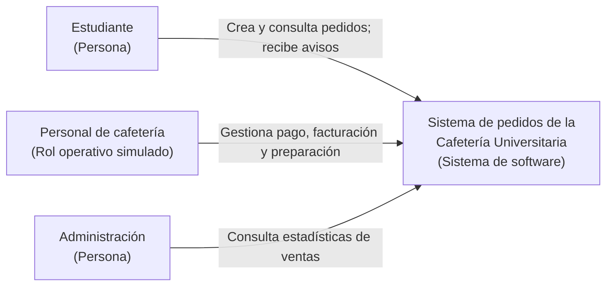

# Diagrama de contexto - C4 Nivel 1

## Sistema de pedidos de la Cafetería Universitaria

### Objetivo

Representar el sistema de la cafetería y los actores
que interactúan con él, identificando sus principales
responsabilidades desde una vista general.

### Diagrama de contexto

### Descripción del sistema

El sistema permite registrar pedidos de los estudiantes,
procesarlos mediante los servicios internos de Caja,
Facturación y Cocina, y notificar cuando están listos.

También dispone de estadísticas que permiten consultar
la cantidad de pedidos y las ventas confirmadas.

### Actores

**Estudiante:** registra pedidos desde la interfaz web,
consulta su estado y puede recibir notificaciones
cuando su pedido está listo.

**Personal de cafetería:** representa las operaciones
de pago, facturación y preparación. En la versión
actual, estas acciones se ejecutan manualmente desde
la interfaz de demostración.

**Administración:** consulta las estadísticas
generadas a partir de los pedidos registrados.

### Alcance y limitaciones

- El sistema está desarrollado para una práctica académica.
- Los pagos y comprobantes son simulados.
- Los datos se almacenan temporalmente en memoria.
- No existe integración con servicios bancarios ni con el SRI.
- No se ha implementado autenticación ni control de roles.
- Los servicios internos se detallarán en el mapa de microservicios.
