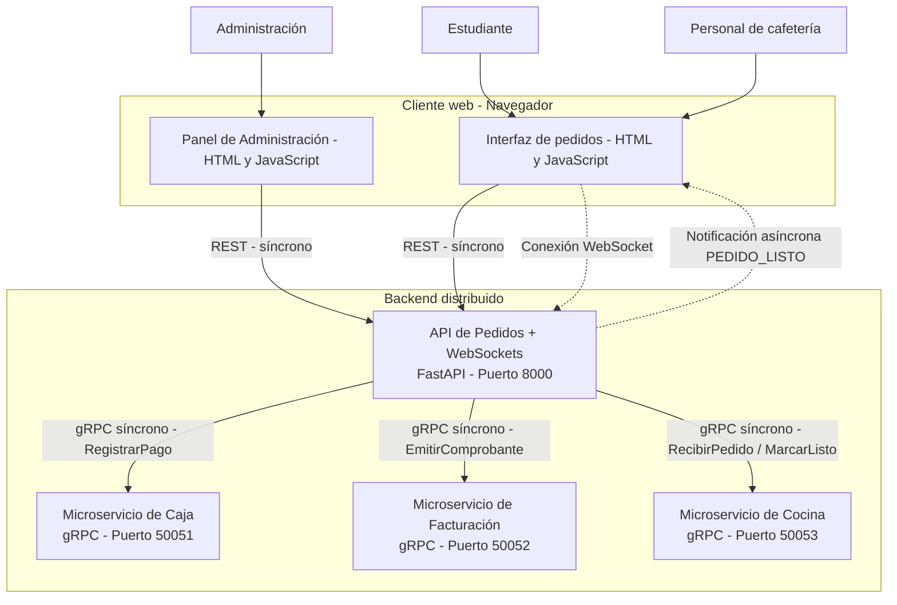

# Mapa de microservicios y mecanismos de comunicación

## Sistema distribuido de la Cafetería Universitaria

### Objetivo

Representar los componentes del sistema y mostrar los
mecanismos utilizados para su comunicación, indicando
si las interacciones son síncronas o asíncronas.

## Diagrama de arquitectura

## Componentes

### API de Pedidos

- Tecnología: Python y FastAPI.
- Puerto: 8000.
- Responsabilidades: crear pedidos, consultar estados,
  coordinar las operaciones internas y notificar
  al estudiante cuando su pedido está listo.
- Comunicación: REST, gRPC como cliente y WebSockets.
- Almacenamiento: memoria.

### Microservicio de Caja

- Tecnología: Python y gRPC.
- Puerto: 50051.
- Responsabilidad: registrar pagos simulados y evitar
  pagos duplicados para un mismo pedido.
- Comunicación: gRPC síncrona.
- Almacenamiento: memoria.

### Microservicio de Facturación

- Tecnología: Python y gRPC.
- Puerto: 50052.
- Responsabilidad: generar comprobantes simulados
  para pedidos con pago confirmado.
- Comunicación: gRPC síncrona.
- Almacenamiento: memoria.

### Microservicio de Cocina

- Tecnología: Python y gRPC.
- Puerto: 50053.
- Responsabilidad: recibir pedidos, consultar su estado
  de preparación y marcarlos como listos.
- Comunicación: gRPC síncrona.
- Almacenamiento: memoria.

### Interfaces web

- Tecnología: HTML, CSS y JavaScript.
- Interfaz de pedidos: /app.
- Panel de Administración: /admin.
- Permiten interactuar con la API mediante REST.
- La interfaz de pedidos también utiliza WebSockets
  para recibir notificaciones.

## Mecanismos de comunicación

| Origen               | Destino                  | Mecanismo  | Tipo                   |
| -------------------- | ------------------------ | ---------- | ---------------------- |
| Interfaz web         | API de Pedidos           | REST       | Síncrona               |
| Panel administrativo | API de Pedidos           | REST       | Síncrona               |
| Pedidos              | Caja                     | gRPC       | Síncrona               |
| Pedidos              | Facturación              | gRPC       | Síncrona               |
| Pedidos              | Cocina                   | gRPC       | Síncrona               |
| Pedidos              | Navegador del estudiante | WebSockets | Notificación asíncrona |

## Secuencia del pedido

1. El estudiante crea un pedido mediante REST.
2. La API registra el pedido como PENDIENTE_PAGO.
3. Se solicita el pago y la API consulta Caja mediante gRPC.
4. Se solicita la facturación y la API consulta Facturación mediante gRPC.
5. Se envía el pedido a Cocina mediante gRPC.
6. Cocina confirma que el pedido está listo mediante gRPC.
7. La API actualiza el estado a LISTO y envía una
   notificación WebSocket al estudiante conectado.

Las operaciones de pago, facturación y preparación
se activan manualmente desde la interfaz actual.

## Decisiones y limitaciones

- Se utilizan tres mecanismos: REST, gRPC y WebSockets.
- REST permite la interacción mediante solicitudes HTTP.
- gRPC permite comunicar los servicios internos.
- WebSockets permite enviar notificaciones asíncronas.
- Los microservicios se ejecutan como procesos independientes.
- Los datos se mantienen en memoria.
- No se utiliza un broker de mensajería.
- Las llamadas gRPC tienen un timeout de tres segundos.
- No se ha implementado autenticación ni autorización.
- La implementación está preparada para una demostración
  local y no representa un despliegue de producción.
